# Rota Vital — Atividade Individual 1: Serverless

**Disciplina:** Infraestrutura de Software  
**Curso:** Análise e Desenvolvimento de Sistemas — CESAR School  
**Período:** 2026.2  
**Atividade:** Individual 1 — Serverless  
**Caminho escolhido:** A — AWS SAM CLI local

---

## 1. Sobre o projeto

O **Rota Vital** é uma aplicação desenvolvida para simular a geração de guias de transporte de hemocomponentes a partir de requisições hospitalares.

Nesta atividade, foi implementada uma função Serverless utilizando Python 3.12 e AWS Lambda, acionada por eventos e por requisições HTTP.

O objetivo foi observar, na prática, o funcionamento de uma aplicação Serverless, analisando o ciclo de vida do ambiente de execução, o reaproveitamento de ambientes, o comportamento de variáveis globais e os limites de tempo de execução.

A atividade foi realizada localmente, utilizando AWS SAM CLI e Docker, sem necessidade de implantação na nuvem ou utilização de cartão de crédito.

## 2. Tecnologias utilizadas

- **Python 3.12:** linguagem utilizada na implementação da função.
- **AWS Lambda:** serviço responsável pela execução da função Serverless.
- **AWS SAM CLI:** ferramenta utilizada para construir e executar a aplicação localmente.
- **Docker:** responsável por fornecer o ambiente de execução local da função.
- **Amazon API Gateway:** serviço simulado localmente pelo SAM para disponibilizar o endpoint HTTP.

## 3. Funcionamento da aplicação

A aplicação recebe uma requisição contendo o identificador do pedido, o hospital de destino e uma lista de bolsas de sangue.

A função processa os dados e retorna uma guia de transporte com status HTTP 201.

**Endpoint:**

`POST http://127.0.0.1:3000/guias`

**Exemplo de requisição:**

```json
{
  "requisicaoId": "R-001",
  "hospital": "H-Recife",
  "bolsas": [
    "O-NEG-0142"
  ]
}
```

**Exemplo de resposta:**

```json
{
  "guia": "G-R-001",
  "hospital": "H-Recife",
  "bolsas": [
    "O-NEG-0142"
  ],
  "invocacaoNesteAmbiente": 1
}
```

O campo `invocacaoNesteAmbiente` foi utilizado para observar o comportamento das variáveis globais durante as invocações da função.

## 4. Estrutura do projeto

```text
serverless-rota-vital/
│
├── events/
│   ├── event.json
│   └── pedido.json
│
├── evidencias/
│   ├── 01-build-succeeded.PNG
│   ├── 02-lambda-primeira-invocacao.PNG
│   ├── 03-lambda-segunda-invocacao.PNG
│   ├── 04-api-http.PNG
│   ├── 04b-api-http-r003-contador-1-2-3.PNG
│   ├── 04-warm-containers-log.PNG
│   ├── 05-warm-containers-resultados.PNG
│   ├── 06-timeout-3s-erro.PNG
│   ├── 07-timeout-3s-log.PNG
│   ├── 08-timeout-10-segundos-parcial.PNG
│   ├── 8-api-timeout-10s-inicializacao.PNG
│   ├── 09-timeout-10s-sucesso.PNG
│   ├── 10-timeout-10s-log.PNG
│   └── 11-configuracao-timeout-10s.PNG
│
├── hello_world/
│   ├── app.py
│   └── requirements.txt
│
├── tests/
│   ├── integration/
│   └── unit/
│
├── template.yaml
├── samconfig.toml
└── README.md
```

## 5. Como executar a aplicação

### 5.1. Pré-requisitos

Para executar o projeto localmente, são necessários:

- Python 3.12.
- Docker Desktop ou runtime compatível.
- AWS SAM CLI.

### 5.2. Construção do projeto

Dentro da pasta do projeto, execute:

```powershell
sam build
```

O comando realiza a construção da aplicação e prepara os arquivos necessários para a execução local.

**Resultado esperado:** `Build Succeeded`.

### 5.3. Invocação direta da função

Para executar a função utilizando um evento JSON:

```powershell
sam local invoke -e events/pedido.json
```

O evento representa uma requisição recebida pela função no formato utilizado pelo API Gateway.

Foram realizadas duas invocações independentes para observar o tempo de execução e o comportamento do ambiente.

### 5.4. Execução por HTTP

Para iniciar a API local:

```powershell
sam local start-api
```

O endpoint fica disponível em:

`http://127.0.0.1:3000/guias`

Em outro terminal PowerShell, execute:

```powershell
$body = '{"requisicaoId":"R-002","hospital":"H-Recife","bolsas":["O-NEG-0142"]}'; Invoke-RestMethod -Uri "http://127.0.0.1:3000/guias" -Method POST -ContentType "application/json" -Body $body
```

A requisição pode ser repetida para observar o comportamento do contador global.

### 5.5. Execução com Warm Containers LAZY

Para iniciar a API utilizando o modo LAZY:

```powershell
sam local start-api --warm-containers LAZY
```

Esse modo inicializa os contêineres sob demanda, quando a função precisa ser executada.

Foram realizadas três requisições HTTP consecutivas para observar o reaproveitamento do ambiente de execução.

## 6. Experimentos realizados

### 6.1. Invocação direta da Lambda

Foram realizadas duas invocações independentes utilizando `sam local invoke`.

Os resultados foram:

| Invocação | Duração | Init Duration | Contador |
|---|---:|---:|---:|
| Primeira | 262,08 ms | 0,06 ms | 1 |
| Segunda | 211,23 ms | 0,05 ms | 1 |

As duas invocações retornaram status HTTP 201 e geraram a guia de transporte.

O contador voltou a 1 em cada execução, pois foram realizadas invocações independentes, sem reaproveitamento do mesmo ambiente entre os comandos.

**Evidências:**

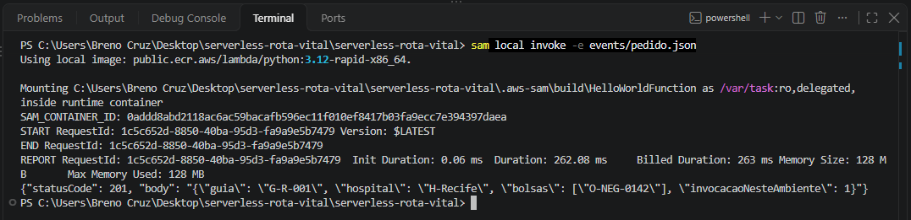

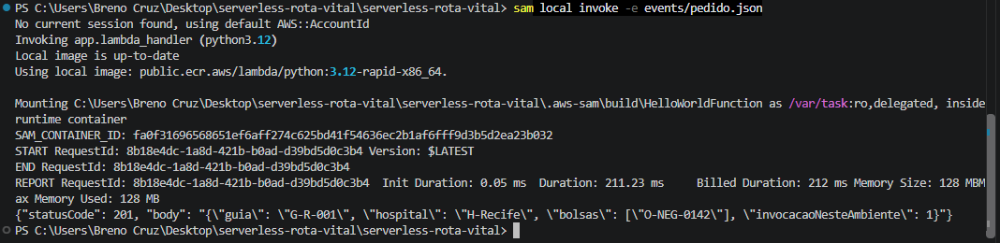

### 6.2. Chamadas HTTP sequenciais

A aplicação foi iniciada utilizando `sam local start-api`.

Foram realizadas três requisições consecutivas para o endpoint `/guias`.

O contador global apresentou os seguintes valores:

| Requisição | Contador |
|---|---:|
| Primeira | 1 |
| Segunda | 2 |
| Terceira | 3 |

Esse resultado demonstrou o reaproveitamento do ambiente de execução local durante as chamadas sequenciais.

**Evidências:**

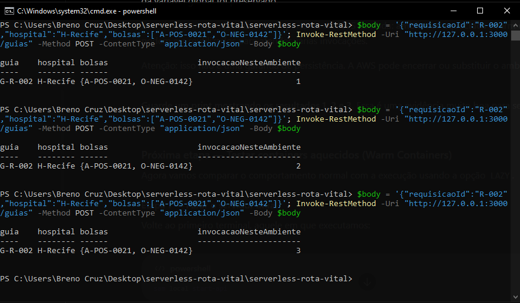

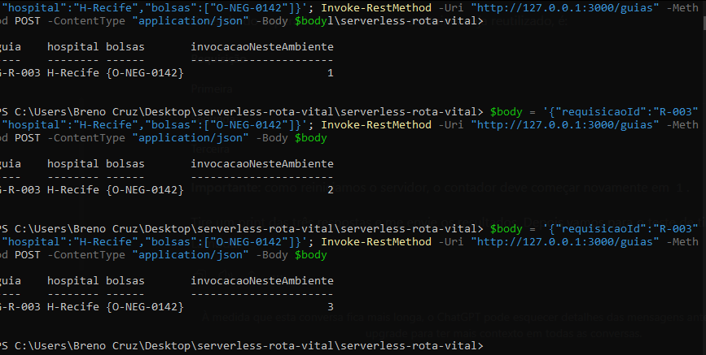

### 6.3. Teste com Warm Containers LAZY

A API foi reiniciada utilizando:

```powershell
sam local start-api --warm-containers LAZY
```

Novamente, foram realizadas três requisições consecutivas.

O contador apresentou os valores 1, 2 e 3. Nos logs, também foi possível observar a mensagem indicando que a função já estava em execução nas chamadas seguintes.

O resultado demonstrou o reaproveitamento do ambiente local. O modo LAZY permite que os contêineres sejam inicializados sob demanda.

**Evidências:**

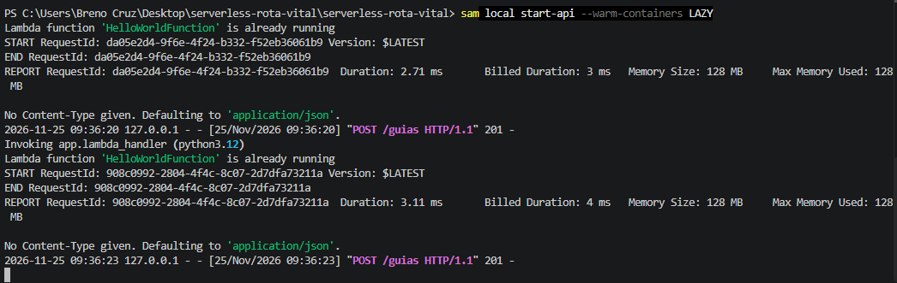

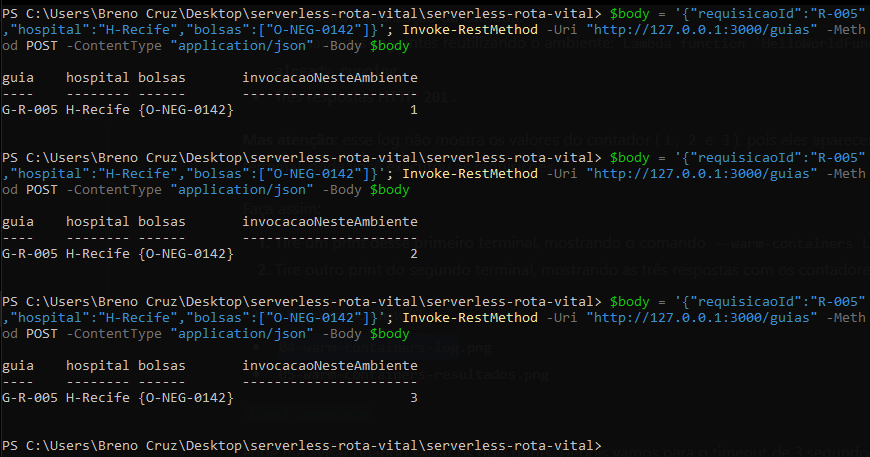

### 6.4. Teste de timeout de 3 segundos

Inicialmente, o timeout da função foi configurado para 3 segundos no arquivo `template.yaml`.

Foi enviada uma requisição contendo o atributo:

```json
{
  "requisicaoId": "R-006",
  "hospital": "H-Recife",
  "bolsas": [
    "O-NEG-0142"
  ],
  "demorar": true
}
```

Quando o atributo `demorar` está habilitado, a função executa uma espera de 5 segundos utilizando `time.sleep(5)`.

Como o tempo de execução ultrapassou o limite de 3 segundos, a função foi interrompida.

O log apresentou:

```text
Function 'HelloWorldFunction' timed out after 3 seconds
Duration: 3000.00 ms
```

A API local registrou uma resposta HTTP 502, enquanto o cliente recebeu uma mensagem de erro interno.

**Evidências:**

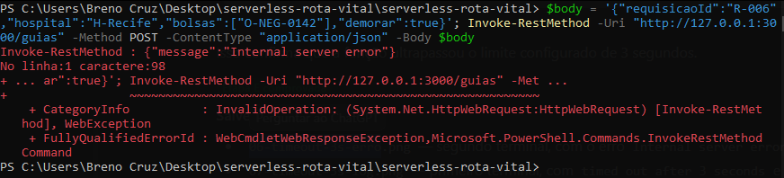

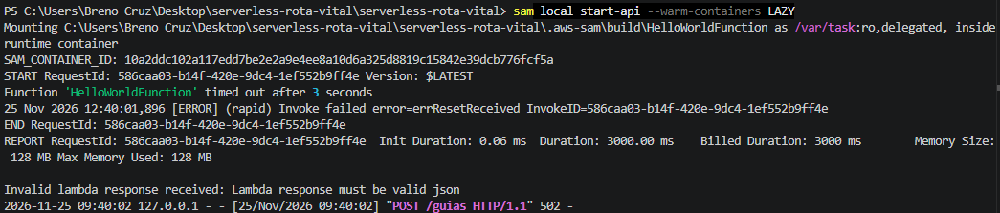

### 6.5. Teste de timeout de 10 segundos

Após o teste anterior, o timeout foi alterado para 10 segundos no arquivo `template.yaml`.

Em seguida, foi executado novamente:

```powershell
sam build
```

A API foi reiniciada e a mesma requisição, que provocava uma espera de 5 segundos, foi enviada novamente.

Dessa vez, a função conseguiu concluir a execução com sucesso.

A resposta retornou:

- Guia: `G-R-006`.
- Hospital: `H-Recife`.
- Status HTTP: `201`.
- Contador: `1`.

O relatório de execução registrou aproximadamente 5.326,74 ms, valor inferior ao limite configurado de 10 segundos.

**Evidências:**

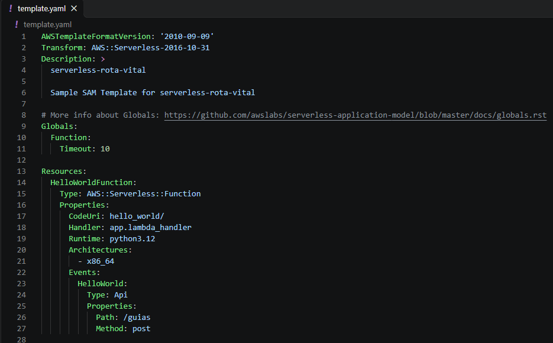

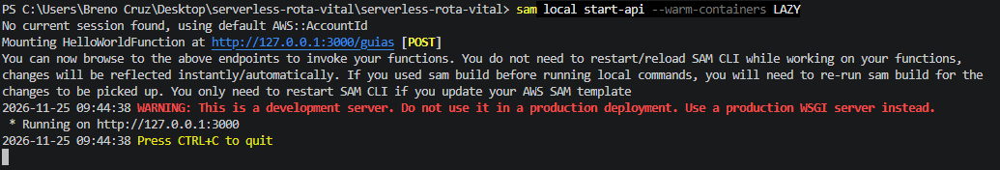

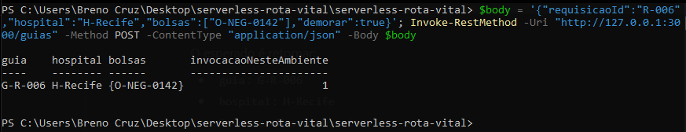

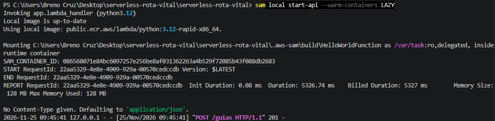

---

## 7. Respostas às perguntas da atividade

### 1. Por que a primeira invocação demorou mais que a segunda? O que acontece na fase de Init?

A primeira invocação pode demorar mais porque precisa preparar o ambiente de execução da função, processo conhecido como Cold Start.

Na fase de Init, o ambiente é inicializado, o runtime do Python é preparado e o código da aplicação e suas dependências são carregados.

Nas invocações seguintes, quando um ambiente já está disponível para reutilização, parte desse processo de inicialização não precisa acontecer novamente, reduzindo o tempo de resposta.

Nos testes locais, a primeira invocação apresentou duração de 262,08 ms, enquanto a segunda apresentou 211,23 ms. Esses valores são resultados do ambiente local do SAM e não representam medições de uma função implantada na AWS.

### 2. O que o campo `invocacaoNesteAmbiente` mostrou com e sem `--warm-containers`? O que isso diz sobre guardar estado numa variável global da função?

Nas chamadas HTTP realizadas com `sam local start-api`, o contador apresentou os valores 1, 2 e 3.

Com `--warm-containers LAZY`, o resultado também foi 1, 2 e 3. Os logs mostraram que o ambiente da função foi reaproveitado nas chamadas seguintes.

Nas invocações independentes realizadas com `sam local invoke`, o contador voltou a 1 em cada execução.

Isso demonstra que uma variável global pode manter seu valor enquanto o mesmo ambiente de execução é reutilizado, mas não existe garantia de que todas as invocações utilizarão o mesmo ambiente.

Por isso, não é recomendado utilizar variáveis globais para armazenar informações importantes ou dados que precisam ser persistidos. Para isso, deve-se utilizar um banco de dados ou outro serviço de armazenamento.

### 3. O que aconteceu com `demorar = true`? Qual é o tempo máximo de uma execução no Lambda, e o que fazer com um trabalho mais longo?

Quando `demorar = true`, a função executa uma espera de 5 segundos.

Com o timeout configurado para 3 segundos, a execução foi interrompida e o SAM registrou o erro de timeout.

Depois que o limite foi aumentado para 10 segundos, a mesma requisição conseguiu ser concluída com sucesso, retornando a guia de transporte.

O tempo máximo de execução de uma função AWS Lambda é de 15 minutos, ou 900 segundos.

Para trabalhos mais longos, podem ser utilizadas alternativas como AWS Step Functions para orquestração de processos, Amazon SQS para processamento assíncrono e AWS Batch para trabalhos em lote.

### 4. Com os preços de us-east-1 da aula, quanto custa um milhão de execuções desta função com 128 MB e 100 ms? Mostrem a conta.

Considerando os valores apresentados na atividade:

- US$ 0,20 por milhão de requisições.
- US$ 0,0000166667 por GB-segundo.
- Memória: 128 MB, equivalente a 0,125 GB.
- Duração: 100 ms, equivalente a 0,1 segundo.

**Primeiro, calculamos o consumo por execução:**

0,125 GB × 0,1 segundo = 0,0125 GB-s.

**Para um milhão de execuções:**

0,0125 × 1.000.000 = 12.500 GB-s.

**Custo de computação:**

12.500 × 0,0000166667 = US$ 0,2083.

**Custo das requisições:**

1.000.000 × 0,20 / 1.000.000 = US$ 0,20.

**Custo total:**

US$ 0,2083 + US$ 0,20 = **US$ 0,4083**.

Portanto, o custo estimado de um milhão de execuções seria de aproximadamente **US$ 0,41**.

Esse cálculo considera apenas os custos de requisições e computação da Lambda, sem incluir outros serviços, armazenamento de logs, transferência de dados ou eventuais cobranças adicionais.

### 5. Em que parte do Rota Vital uma função assim faria sentido, e em qual não faria?

Uma função Serverless faria sentido em atividades pontuais do Rota Vital, como gerar guias de transporte, processar solicitações hospitalares, enviar notificações e registrar eventos relacionados à movimentação de hemocomponentes.

Essas tarefas podem ser executadas sob demanda, sem a necessidade de manter um servidor dedicado funcionando continuamente.

Por outro lado, não seria adequado depender de uma variável global para armazenar informações críticas, como estoque de bolsas, histórico de movimentações ou dados de requisições. Essas informações precisam de persistência confiável, utilizando um banco de dados.

Também seria necessário avaliar outras soluções para processos muito longos ou que exigem execução contínua, utilizando serviços de orquestração ou processamento assíncrono quando necessário.

---

## 8. Uso de IA

**Ferramenta utilizada:** ChatGPT.

**Finalidade:** auxílio na compreensão dos conceitos de Serverless, orientação durante a configuração e execução local da aplicação, interpretação dos resultados dos testes, organização das evidências e elaboração da documentação do projeto.

**Validação:** os comandos foram executados localmente pelo estudante, os resultados foram conferidos nos terminais e as evidências foram registradas por meio de capturas de tela. As explicações e os resultados documentados foram revisados com base nos experimentos realizados.

A utilização da ferramenta foi realizada como apoio ao desenvolvimento e à aprendizagem, mantendo a execução, validação e compreensão do projeto pelo estudante.

## 9. Vídeo demonstrativo

**Link do vídeo:** https://youtu.be/AFOR9k9MLUs

O vídeo demonstrativo apresenta a execução da função por evento, as chamadas HTTP e o experimento de timeout, conforme solicitado na atividade.

## 10. Considerações finais

A atividade permitiu compreender, na prática, conceitos fundamentais da arquitetura Serverless, como execução sob demanda, Cold Start, reaproveitamento de ambientes, variáveis globais e limites de tempo de execução.

Os experimentos demonstraram que o comportamento de uma função pode variar conforme o ambiente de execução é inicializado ou reaproveitado, além de evidenciar a importância de configurar corretamente o timeout.

O uso do AWS SAM CLI e do Docker possibilitou realizar os testes localmente, sem necessidade de implantação na nuvem, permitindo observar os principais comportamentos estudados na aula.
